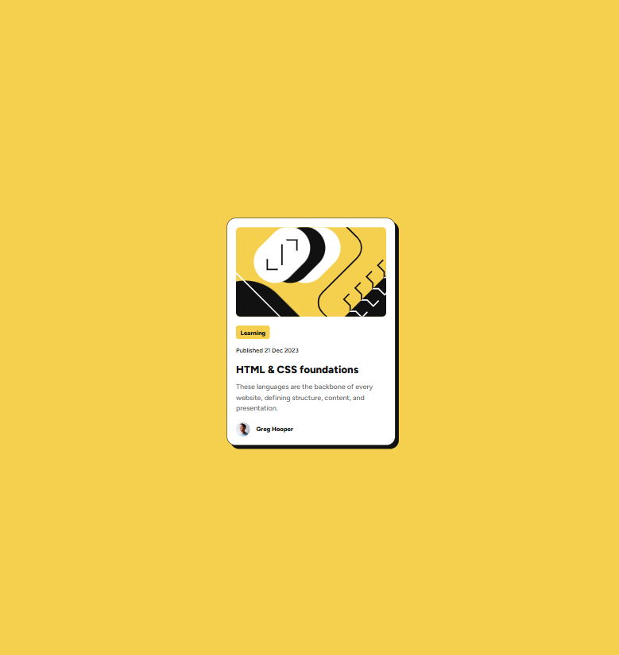
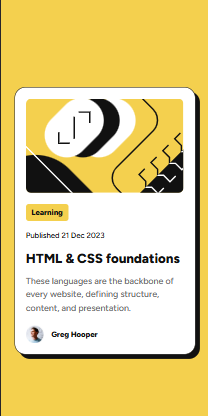

# Frontend Mentor - Blog preview card solution

Esta es una solución al reto [Blog preview card de Frontend Mentor](https://www.frontendmentor.io/challenges/blog-preview-card-ckPaj01IcS). El objetivo fue construir una tarjeta de vista previa de un artículo, reproducir el diseño proporcionado y mantener una experiencia accesible y responsiva.

## Tabla de contenidos

- [Descripción general](#descripción-general)
  - [El reto](#el-reto)
  - [Capturas](#capturas)
  - [Enlaces](#enlaces)
- [Proceso](#proceso)
  - [Tecnologías](#tecnologías)
  - [Implementación](#implementación)
  - [Aprendizajes](#aprendizajes)
  - [Mejoras futuras](#mejoras-futuras)
  - [Colaboración con IA](#colaboración-con-ia)
- [Ejecución local](#ejecución-local)
- [Autor](#autor)

## Descripción general

### El reto

Los usuarios deben poder:

- Ver la tarjeta correctamente desde pantallas de 320 px hasta pantallas grandes.
- Identificar el estado `hover` al pasar el cursor sobre el título.
- Identificar el estado de foco al navegar con el teclado.
- Leer el contenido sin desbordamientos horizontales.

### Capturas

#### Escritorio

#### Móvil

### Enlaces

- Repositorio: [github.com/JesuSaid/blog-preview-card](https://github.com/JesuSaid/blog-preview-card)
- Reto original: [Frontend Mentor - Blog preview card](https://www.frontendmentor.io/challenges/blog-preview-card-ckPaj01IcS)

## Proceso

### Tecnologías

- HTML5 semántico.
- CSS3.
- Flexbox.
- Fuentes locales mediante `@font-face`.
- Diseño responsivo con enfoque mobile-first.
- Git y Conventional Commits para registrar avances relacionados.

### Implementación

El proyecto se desarrolló en pequeños bloques relacionados:

1. Se creó la estructura semántica mediante `main`, `article`, `time` y `footer`.
2. Se configuró la familia Figtree con los pesos 500 y 800 incluidos en el proyecto.
3. Se centró la tarjeta con Flexbox y se creó un contenedor adaptable mediante `width`, `max-width` y espacio lateral.
4. Se hizo responsiva la ilustración principal y se añadieron bordes redondeados.
5. Se diseñaron la categoría, fecha, título, descripción y sección del autor.
6. Se agregaron estados `hover` y `focus-visible` al enlace del título.
7. Se ajustaron el borde y la sombra para acercarlos al diseño de referencia.

### Aprendizajes

Durante el desarrollo se practicaron los siguientes conceptos:

- Elegir etiquetas HTML por su significado y no por su apariencia.
- Utilizar `datetime` para proporcionar una fecha legible por máquinas.
- Diferenciar la responsabilidad de HTML, que define estructura e interacción, y CSS, que define presentación.
- Comprender el modelo de caja y el efecto de `padding`, `border`, `margin` y `box-sizing`.
- Usar `padding-inline` para reservar espacio lógico a ambos lados de un contenedor.
- Combinar `width: 100%` con `max-width` para crear componentes adaptables.
- Aprovechar la herencia para compartir tipografía, altura de línea y color.
- Aplicar pseudoclases al elemento que realmente recibe la interacción.
- Mantener visible el foco para usuarios que navegan con teclado.
- Organizar el trabajo mediante commits pequeños con una intención concreta.

### Mejoras futuras

- Añadir una URL real al enlace del artículo en lugar del marcador `#`.
- Publicar el proyecto y añadir la URL de la demostración en vivo.
- Continuar practicando componentes responsivos y pruebas de accesibilidad.

### Colaboración con IA

Se utilizó Codex como mentor durante el desarrollo. La colaboración se centró en revisar avances, explicar conceptos, detectar propiedades sin efecto y orientar la depuración mediante pistas. La implementación se realizó de forma incremental para comprender cada decisión en lugar de copiar una solución completa.

## Ejecución local

No se necesitan dependencias ni un proceso de compilación:

1. Clona el repositorio.
2. Abre la carpeta del proyecto.
3. Abre `index.html` en un navegador.

## Autor

- GitHub: [@JesuSaid](https://github.com/JesuSaid)
